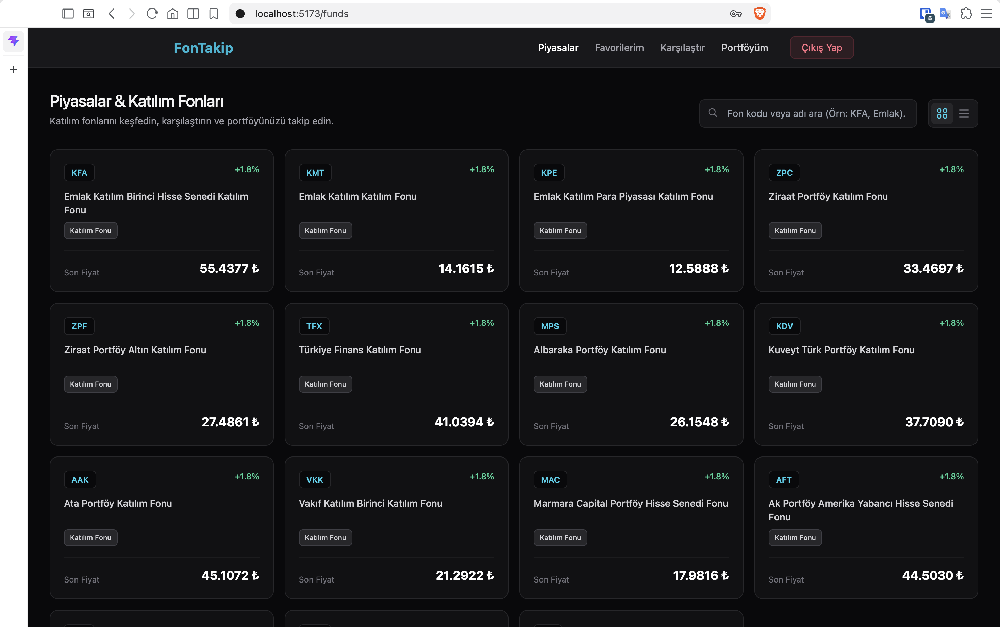
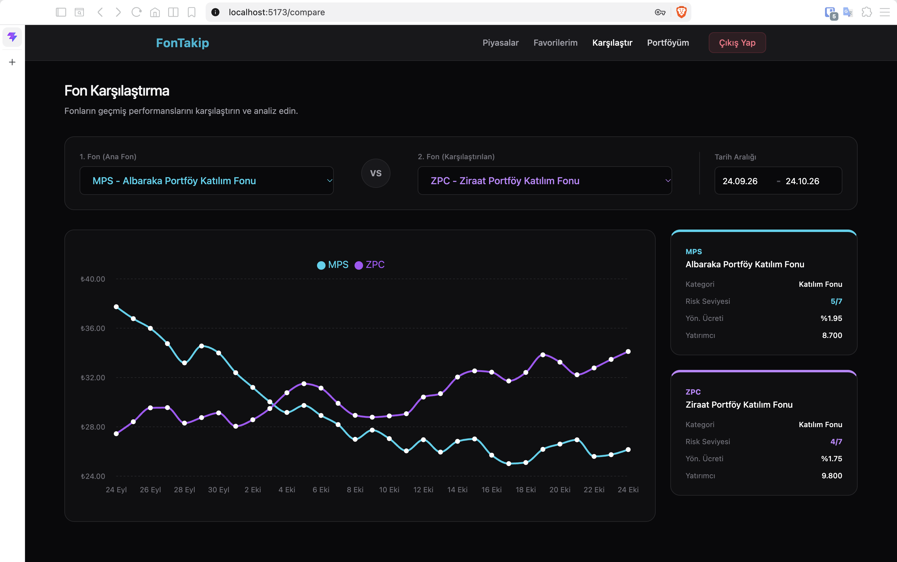
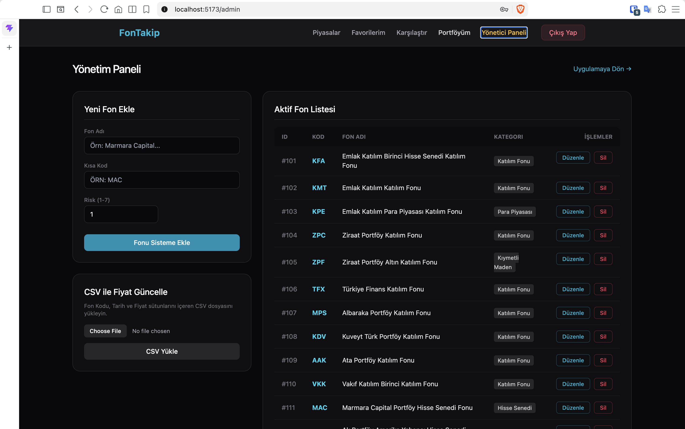

# FonTakip

### Participation Fund Tracking and Portfolio Management

FonTakip is a full-stack web application designed to explore, compare, and track participation investment funds.

Inspired by Türkiye's TEFAS platform and financial treasury applications, FonTakip demonstrates modern software engineering practices through a React frontend, an ASP.NET Core Web API, and a SQL Server database.

The project focuses on fund management, portfolio tracking, data visualization, and role-based access control.

> **Note:** Fund prices are simulated for educational and demonstration purposes. The application does not provide live financial market data.

## Features

- **Fund Explorer:** Browse participation investment funds and view their key information.
- **Fund Comparison:** Compare historical fund performance using interactive charts.
- **Portfolio Tracking:** Organize and monitor funds within a personal portfolio.
- **Authentication & Authorization:** Secure user registration and login using JWT-based authentication and role-based access control.
- **Admin Dashboard:** Manage investment funds through CRUD operations.
- **CSV Import:** Update fund price data by uploading CSV files.
- **Automated Price Simulation:** Generate simulated daily fund price movements using a .NET BackgroundService.
- **Responsive Interface:** Access the application through a modern React interface styled with Tailwind CSS.

## Tech Stack

| Layer | Technologies |
|-------|--------------|
| Frontend | React 18, Vite, Tailwind CSS |
| Routing | React Router |
| HTTP Client | Axios |
| Data Visualization | Recharts |
| Backend | C#, ASP.NET Core Web API (.NET 8) |
| Database | Microsoft SQL Server |
| ORM | Entity Framework Core |
| Authentication | JSON Web Tokens (JWT) |
| Background Processing | .NET BackgroundService |
| Containerization | Docker, Docker Compose |
| API Documentation | Swagger UI |

## Architecture

FonTakip follows a layered full-stack architecture consisting of four main components:

**Frontend — React**

Provides the user interface for exploring funds, comparing performance, managing portfolios, and accessing administrative features.

**Backend — ASP.NET Core Web API**

Handles HTTP requests, business logic, authentication, authorization, and fund management operations.

**Database — SQL Server**

Stores application data, user accounts, investment funds, and historical fund price records. Entity Framework Core is used for database access and migrations.

**Background Processing — .NET BackgroundService**

Generates simulated daily fund price updates for demonstration purposes.

The backend and database run in Docker containers, while the React frontend runs locally using Vite.

## Screenshots

### Fund Explorer

Browse participation funds and explore their key information.



### Fund Comparison

Compare historical fund performance using interactive charts and view fund-specific information.



### Admin Dashboard

Manage investment funds and import fund price data through CSV files.



## Getting Started

### Prerequisites

Make sure the following tools are installed:

- Git
- Docker Desktop
- Docker Compose
- Node.js and npm

### 1. Clone the Repository

```bash
git clone https://github.com/ZaferMert/FonTakip.git
cd FonTakip
```

### 2. Configure Environment Variables

Create a local environment file from the provided example:

```bash
cp .env.example .env
```

Open `.env` and configure the following variables:

| Variable | Description |
|----------|-------------|
| `MSSQL_SA_PASSWORD` | Password for the SQL Server administrator account |
| `JWT_SECRET_KEY` | Secret key used for signing JWT authentication tokens |

Use a strong, unique password for SQL Server.

Generate a cryptographically secure JWT signing key:

```bash
openssl rand -hex 32
```

Copy the generated value into the `JWT_SECRET_KEY` variable in your local `.env` file.

**Security:** Never commit `.env`, passwords, or other sensitive credentials to version control.

### 3. Start the Backend and Database

From the project root, run:

```bash
docker compose up -d --build db api
```

Docker Compose starts the following services:

| Service | Address |
|---------|---------|
| SQL Server | `localhost:1433` |
| ASP.NET Core API | `http://localhost:5043` |
| Swagger UI | `http://localhost:5043/swagger` |

The application applies Entity Framework Core database migrations during startup.

The first startup may take longer while Docker downloads the required images and initializes SQL Server.

### 4. Start the Frontend

Open a new terminal and navigate to the frontend directory:

```bash
cd FonTakip.UI
```

Install the required dependencies:

```bash
npm ci
```

Start the Vite development server:

```bash
npm run dev
```

Open the application in your browser:

**http://localhost:5173**

### 5. Create a User Account

Open the application and register a new account using the registration page.

Newly registered accounts receive the `User` role by default.

Administrative privileges must be assigned separately by an authorized database administrator.

No default administrator credentials are included in this repository.

### 6. Stop the Application

Stop the frontend development server by pressing `Ctrl+C` in its terminal.

From the project root, stop the backend and database containers:

```bash
docker compose stop
```

This stops the services without deleting the database volume.

To restart the existing containers:

```bash
docker compose start
```

**Important:** Docker Compose commands must use the same project name to access the same containers and database volume. If you start the application with a custom project name using `-p`, use that name for subsequent commands.

## Configuration & Security

FonTakip uses environment variables to manage sensitive application configuration.

The repository includes `.env.example` as a configuration template. Actual credentials must be stored locally in `.env`, which is excluded from Git tracking.

Authentication is implemented using JWT, with separate authorization rules for standard users and administrators.

The application is intended for local development, learning, and portfolio demonstration. Additional security hardening would be required before a public production deployment.

## Project Status

FonTakip is an educational and portfolio project developed to explore:

- Full-stack web application development
- RESTful API design
- JWT authentication and role-based authorization
- Relational database design
- Entity Framework Core
- Background services
- Interactive data visualization
- Docker-based development environments

The application uses simulated data and is not intended for real financial trading or investment decisions.

## Author

**Zafer Mert Serinken**

Computer Engineering Student

[GitHub Profile](https://github.com/ZaferMert)

## Development Process

This project was developed with extensive assistance from AI coding tools, which generated a substantial portion of the implementation.

My primary responsibilities included defining project requirements, guiding the development process, reviewing the application's behavior, and performing functional testing.

The project serves as a practical learning experience in full-stack development, software architecture, and AI-assisted development workflows.